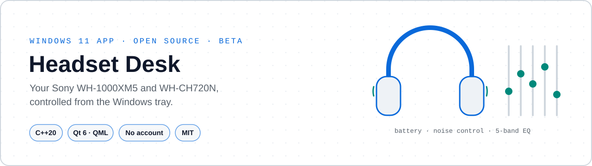
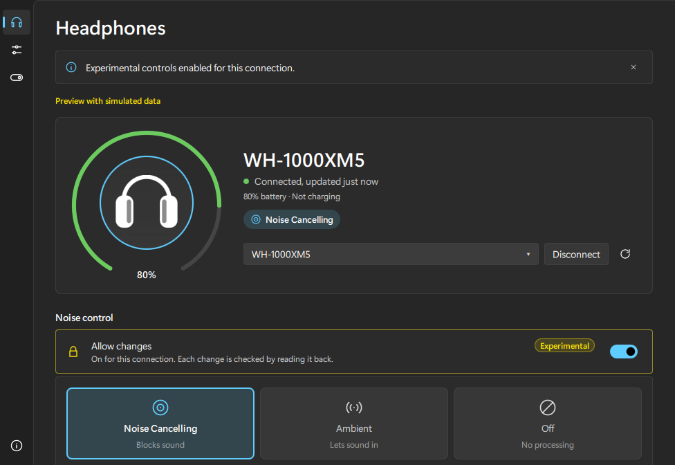
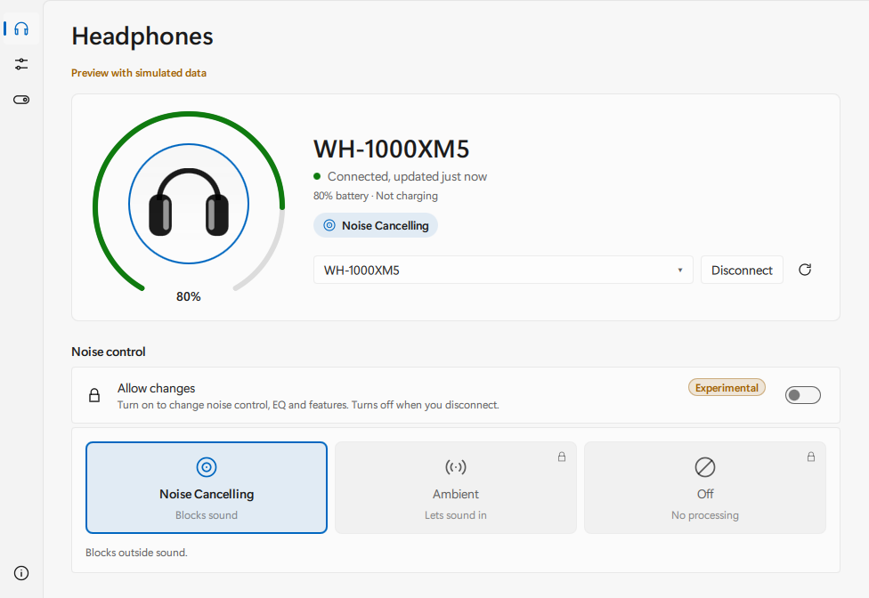
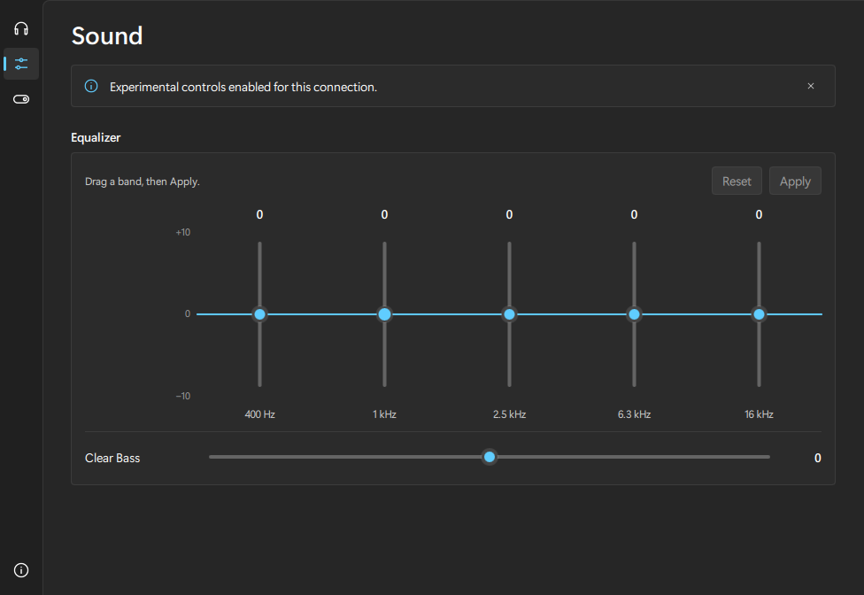
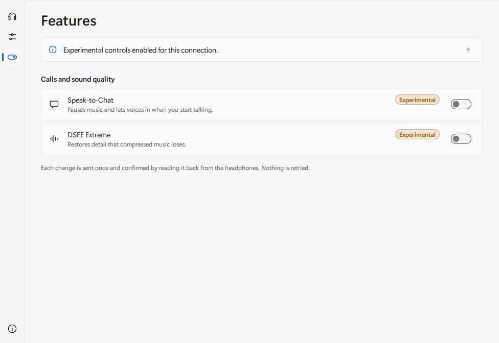
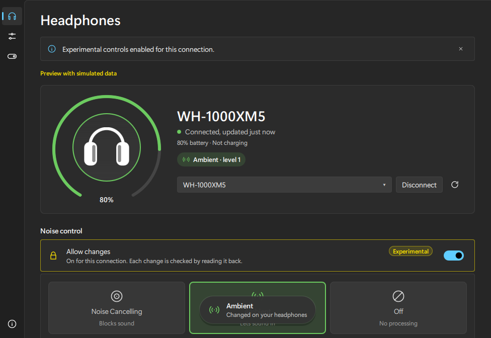

<picture>
  <source media="(prefers-color-scheme: dark)" srcset="docs/images/banner-dark.svg">
  
</picture>

<p align="center">
  <a href="https://github.com/ashwinpr15/headset-desk/releases/latest"></a>
  <a href="https://github.com/ashwinpr15/headset-desk/actions/workflows/desktop-release.yml"></a>
  <a href="https://github.com/ashwinpr15/headset-desk/actions/workflows/windows.yml"></a>
  
  <a href="LICENSE"></a>
</p>

Sony keeps the controls for its headphones in a phone app. **Headset Desk** brings the everyday ones to your Windows PC: check the battery, switch noise cancelling, tweak the EQ, and get back to work. It sits quietly in the tray, needs no account, and never phones home.

<p align="center">
  <a href="https://github.com/ashwinpr15/headset-desk/releases/download/v0.6.0-beta.1/headset-desk-v0.6.0-beta.1-windows-x64-setup.exe"><b>⬇ Download the installer (0.6.0 beta)</b></a>
  &nbsp;·&nbsp; <a href="https://github.com/ashwinpr15/headset-desk/releases/download/v0.6.0-beta.1/headset-desk-v0.6.0-beta.1-windows-x64.zip">Portable ZIP</a>
  &nbsp;·&nbsp; <a href="https://github.com/ashwinpr15/headset-desk/releases">All releases</a>
</p>

<p align="center">
  
  
</p>
<p align="center">
  
  
</p>
<p align="center">
  
</p>
<p align="center"><sub>Screenshots from the release build, using simulated data.</sub></p>

## What it does

- 🔋 **See what's going on:** model, battery level (as a ring around the headphones), charging state, firmware and the codec the headset reports. If it doesn't know a value, it shows a dash instead of guessing.
- 🎧 **Noise control:** Noise Cancelling, Ambient or Off, with an Ambient level from 1 to 20 and voice passthrough.
- 🔁 **Stays in sync with your headphones:** press the NC/Ambient button on the headset and the app follows, with a small toast so you can see what changed. Reading this never sends anything to the headphones.
- ⚡ **Quick switch from the tray:** right-click the tray icon to pick Noise Cancelling, Ambient or Off without opening the window.
- 🎚️ **Sound:** a five-band EQ (400 Hz to 16 kHz) with a live curve, plus Clear Bass from −10 to +10.
- ✨ **Extras (experimental):** Speak-to-Chat on the XM5, and DSEE Extreme / DSEE.
- 🪟 **Feels like Windows 11:** a collapsible navigation pane, light and dark themes that follow Windows, keyboard shortcuts (Ctrl+1–4 for pages, F5 to refresh), keyboard focus rings, and no animation when Windows animation effects are off.
- 🧘 **Stays out of the way:** closing the window keeps it in the tray with the connection alive; **Quit** in the tray menu exits. Opening it twice just brings the first window forward.
- 🔒 **Private by design:** no cloud account, analytics, auto-updater, background service or launch at sign-in.

## Getting started

1. **Install.** Run the installer and open **Headset Desk** from Start. No admin rights, Qt or developer tools needed. Prefer portable? Extract the *whole* ZIP and run `headset-desk.exe` from inside the folder.
2. **Pair your headphones** in Windows Bluetooth settings and turn them on. Close any other headset-control tools first.
3. **Connect.** The app connects on its own when Windows reports a supported headset as active. If not, click **Connect**.
4. **Change settings when you're ready.** Everything starts read-only. Tap a noise mode and the app offers **Turn on and switch**, or turn on **Allow changes** yourself on the Headphones page. Then drag the EQ and click **Apply**, or flip a switch on **Features**.

> **Heads-up:** the app and installer aren't code-signed yet, so Windows SmartScreen may warn about an unrecognized app. Only download from this repo's [Releases](https://github.com/ashwinpr15/headset-desk/releases), and check `CHECKSUMS.txt` if you'd like to verify your file.

## Is it safe for my headphones?

Short answer: it's careful by design, but it's still a beta.

- **Read-only until you say so.** Nothing is sent until you turn on **Allow changes**, and that switch resets whenever you disconnect, reconnect or change headsets.
- **One command, then a check.** Each change is sent once, and the app reads the setting back to confirm it. If the headphones report something different, you'll see what they said. Nothing is ever resent.
- **No risky commands.** There are no firmware updates and no power commands.

### Tested so far

| Headphones | Readings | Changing settings |
|---|---|---|
| **WH-1000XM5** | ✅ Checked on firmware 2.5.1 | Noise control switched Off → NC → Ambient → Off and confirmed by readback. Works with 0.6.0, including following the headset's noise button. |
| **WH-CH720N** | ✅ Checked on firmware 1.1.4 | Works with 0.6.0. The swapped Ambient/NC fix from 0.5.0 is confirmed, and the app follows the headset's noise button. |

Changing settings hasn't been tested across other firmware versions or units yet. Other models and renamed headsets aren't supported. If you try it, I'd love to hear how it went: [open an issue](https://github.com/ashwinpr15/headset-desk/issues/new/choose) with your model and firmware. The full test notes are in [hardware validation](docs/hardware-validation.md), [CH720N notes](docs/wh-ch720n-validation.md) and [beta validation](docs/desktop-validation.md).

## Build it yourself

You'll need C++20, CMake 3.25+, Ninja, Qt **6.8.3** (`mingw_64`) and its matching MinGW **GCC 13.1.0** kit, with the compiler and Qt `bin` folders on your PATH.

```powershell
cmake -S . -B build-desktop -G Ninja -DCMAKE_BUILD_TYPE=Release -DHEADSET_DESK_BUILD_DESKTOP=ON -DCMAKE_PREFIX_PATH=C:/Qt/6.8.3/mingw_64
cmake --build build-desktop --parallel 4
ctest --test-dir build-desktop --output-on-failure
```

A plain CMake build (without the desktop flag) builds just the core library and a read-only diagnostics tool, with no Qt needed. Every change is built by GitHub Actions, which runs the offline tests, checks the bundled runtime, and installs, verifies and uninstalls the installer.

**Learn more:** [architecture](docs/architecture.md) · [building, deploying and packaging](docs/desktop-build.md) · [release notes](docs/releases/)

## Project layout

```
headset-desk/
├── core/             # device discovery, profiles and sessions (no Qt)
├── apps/desktop/     # the Qt/QML Windows app
├── apps/diagnostics/ # read-only command-line diagnostics
├── vendor/           # imported sony-device-center protocol code (MIT)
├── tests/            # offline tests and recorded hardware fixtures
├── packaging/        # Inno Setup installer script and runtime notices
├── validation/       # test reports from release checks
├── docs/             # architecture, build and validation notes, screenshots
└── .github/          # CI workflows and issue templates
```

## Credits and license

Headset Desk builds on the protocol and Windows transport work in [marconvcm/sony-device-center](https://github.com/marconvcm/sony-device-center) (MIT); imported files keep their original notices, and the changes are listed in [attribution](docs/attribution.md). New Headset Desk code is released under the [MIT License](LICENSE).

Qt 6.8.3 is dynamically linked under the LGPLv3. Downloads include the Qt and runtime notices, and the exact Qt sources are published alongside each release. You're free to swap in compatible Qt DLLs and plugins, and to reverse-engineer the app to debug those replacements. If you redistribute it, please keep the notices and source availability intact.

Headset Desk is an independent project and isn't affiliated with or endorsed by Sony. No Sony artwork is included.
